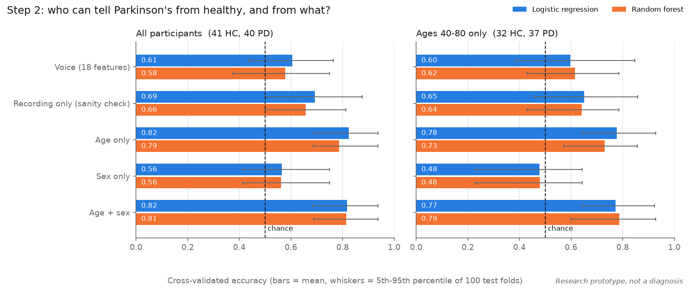
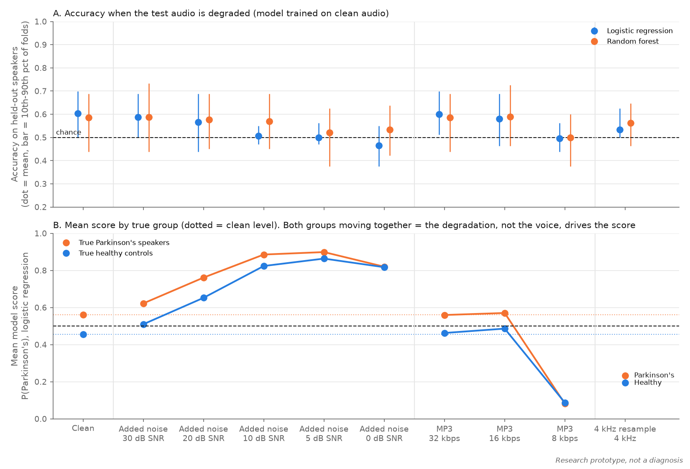

# Sustained-vowel voice analysis for Parkinson's disease: a research prototype

> ⚠️ **RESEARCH PROTOTYPE, NOT A DIAGNOSIS.** This is a high-school research project.
> It has not been clinically validated, cannot tell anyone whether they have Parkinson's
> disease, and must not be used to make any health decision.

## In one paragraph

We extracted 18 acoustic features (pitch, jitter, shimmer, harmonics-to-noise ratio and
13 MFCC means) from 81 telephone recordings of a sustained "ahhh" (41 healthy controls,
40 people with Parkinson's), trained two simple classifiers, and evaluated them with
speaker-grouped cross-validation. **The voice model reached about 60% accuracy (chance ≈ 51%),
which a permutation test shows is not significantly better than chance (p ≈ 0.2).**
Three sanity checks point the same way:
**a model that ignores the voice and uses only recording properties (duration, loudness,
noise floor, silence) did better (≈ 69%, p = 0.002)**, **age alone did much better (≈ 82%)**, and
**mild noise or compression moved the scores of both groups together**, until at heavy
degradation the model called nearly everyone "Parkinson's" (noise) or "healthy"
(8 kbps MP3, 4 kHz). The honest conclusion is that **this dataset is too small and too
confounded to show that these features detect Parkinson's**. The project is better read
as a demonstration of *how to check* a voice-biomarker claim than as a detector.

---

## 1. Data

Source: figshare dataset of sustained /a/ recordings made by participants on their own
telephones (see [Citations](#citations)). Files: `data/figshare/HC_AH/HC_AH/*.wav`,
`data/figshare/PD_AH/PD_AH/*.wav`, `data/figshare/Demographics_age_sex.xlsx`
(sheet `Parselmouth`: `Sample ID`, `Label`, `Age`, `Sex`).

What the data inspection (step 0) found:

| | Healthy controls | Parkinson's |
|---|---|---|
| Recordings | 41 | 40 |
| Age, mean ± SD (range) | 47.7 ± 14.3 (18-79) | 67.0 ± 9.0 (43-85) |
| Under 40 / over 60 | 12 / 7 | 0 / 31 |
| Female / male | 25 / 16 | 19 / 21 |
| Duration, median (range) | 2.9 s (1.6-5.8) | 3.3 s (1.5-7.2) |

* `Sample ID` = WAV file name without `.wav`; every file has exactly one row and vice versa.
* One recording per ID, no duplicate files. There is no separate speaker column, so
  repeat speakers under different IDs can't be ruled out completely (a similarity check
  found no obvious duplicates).
* **All audio is 8 kHz mono** (telephone bandwidth, 0-4 kHz) and **every file is
  peak-normalised to exactly 1.0**. Leading silence was already trimmed from every file.
* **Age is strongly confounded** with diagnosis (p ≈ 2 × 10⁻⁸, Mann-Whitney).
* **Signs that the two groups were collected differently:** the two groups use
  different Sample ID formats (`AH_<3 digits><letter>_<UUID>` vs `AH_<9 digits>-<UUID>`), and ages are
  whole numbers for controls but decimals for Parkinson's. Any difference between
  the groups in how they were recorded could be learned instead of the disease.

## 2. Methods

All code is in this folder; every script is commented.

| File | Purpose |
|---|---|
| `features.py` | **The single feature-extraction function** used for training, degraded audio and live recordings. Also the recording-only sanity features. |
| `audio_tools.py` | ffmpeg conversion and the degradations (noise, MP3, 4 kHz). Shared by step 3 and the app. |
| `common.py` | Model definitions, grouped CV splitter, chart style. |
| `step1_extract_features.py` | Builds `results/features.csv`. |
| `step2_train_evaluate.py` | Cross-validation, sanity checks, permutation test, final models. |
| `step3_robustness.py` | Degradation test. |
| `step4_covariates.py` | Covariate analysis: age + sex vs voice vs both, all speakers and age-matched. |
| `app.py` | Streamlit app. |

### 2.1 Feature extraction (`features.py`)
For every recording: mix to mono → resample to 8 kHz (so a 48 kHz laptop recording
matches the telephone training data) → peak-normalise → trim to the span between the
first and last voiced frame → measure with Praat via Parselmouth:

* **Pitch (F0)** mean and SD over voiced frames (autocorrelation, 75-500 Hz).
* **Jitter (local)** and **shimmer (local)** from a cross-correlation PointProcess,
  Praat default parameters (period 0.1-20 ms, max period factor 1.3, max amplitude factor 1.6).
* **HNR** (cross-correlation harmonicity, mean over defined frames).
* **13 MFCC means** (c0-c12; Praat MFCC, 15 ms windows, 5 ms steps, mel filters up to 4 kHz).

**Recording-only sanity features** (computed on the raw file, never given to the voice
model): clip duration, overall RMS loudness (dBFS), noise floor (5th percentile of 25 ms
frame energy), leading and trailing silence (frames > 30 dB below the loudest frame).

### 2.2 Models and evaluation (`step2_train_evaluate.py`)
* **Logistic regression** (standardised features, C = 1, balanced class weights) and
  **random forest** (300 trees, min. 2 samples per leaf, balanced). Settings were fixed
  in advance; nothing was tuned on this data.
* **Stratified grouped 5-fold cross-validation, grouped by speaker**, repeated 20 times
  with different shuffles = **100 test folds**. A speaker is never in both training and
  test data. Feature scaling is fitted inside each training fold.
* Metrics: accuracy, **sensitivity** (Parkinson's correctly flagged), **specificity**
  (controls correctly cleared), AUC, with the spread across folds.
* Sanity checks with the identical procedure: recording-only features, age only, sex
  only, age + sex. The whole analysis was repeated on the **ages 40-80** subset.
* **Permutation test:** retrain on speaker-level shuffled labels (1000 shuffles for
  logistic regression, 100 for random forest) to see how often chance matches the real score.

### 2.3 Robustness test (`step3_robustness.py`)
Models are trained on clean features from the training speakers. The **held-out**
speakers' audio is degraded and passed through the same `extract_features()`:
white noise at 30, 20, 10, 5, 0 dB SNR; MP3 (ffmpeg/LAME) at 32, 16, 8 kbps; and
resampling to 4 kHz (removes everything above 2 kHz). The original plan's "8 kHz
resample" was dropped because the data are already 8 kHz. 5 × 5-fold grouped CV.

## 3. Results

### 3.1 Cross-validated accuracy (100 test folds; mean, SD across folds)



**All participants (41 HC, 40 PD).** Chance = 50.6%.

| Features | Model | Accuracy (SD) | 5th-95th pct of folds | Sensitivity | Specificity | AUC |
|---|---|---|---|---|---|---|
| Voice (18) | Logistic regression | 0.606 (0.103) | 0.44-0.76 | 0.594 | 0.617 | 0.630 |
| Voice (18) | Random forest | 0.578 (0.120) | 0.38-0.75 | 0.595 | 0.562 | 0.605 |
| **Recording only (sanity)** | Logistic regression | **0.692** (0.094) | 0.50-0.88 | 0.593 | 0.789 | 0.757 |
| Recording only (sanity) | Random forest | 0.657 (0.103) | 0.50-0.81 | 0.559 | 0.752 | 0.691 |
| **Age only** | Logistic regression | **0.824** (0.086) | 0.69-0.94 | 0.821 | 0.827 | 0.854 |
| Age only | Random forest | 0.787 (0.080) | 0.69-0.94 | 0.834 | 0.741 | 0.828 |
| Sex only | Logistic regression | 0.565 (0.111) | 0.41-0.75 | 0.525 | 0.604 | 0.509 |
| Age + sex | Logistic regression | 0.817 (0.089) | 0.68-0.94 | 0.815 | 0.819 | 0.844 |

**Ages 40-80 only (32 HC, 37 PD; median age 51 vs 68, so still confounded).**

| Features | Model | Accuracy (SD) | AUC |
|---|---|---|---|
| Voice (18) | Logistic regression | 0.597 (0.133) | 0.638 |
| Voice (18) | Random forest | 0.615 (0.117) | 0.658 |
| Recording only (sanity) | Logistic regression | 0.650 (0.128) | 0.739 |
| Age only | Logistic regression | 0.777 (0.089) | 0.801 |

Full table: `results/step2_cv_results.csv`.

**Permutation test** (one fixed 5-fold split; p = fraction of shuffled-label runs that
matched or beat the real accuracy):

| Features | Model | Real accuracy | Mean accuracy with shuffled labels | p | Shuffles |
|---|---|---|---|---|---|
| Voice (18) | Logistic regression | 0.568 | 0.501 | **0.19** | 1000 |
| Voice (18) | Random forest | 0.568 | 0.506 | **0.23** | 100 |
| Recording only (sanity) | Logistic regression | 0.716 | 0.502 | **0.002** | 1000 |
| Recording only (sanity) | Random forest | 0.630 | 0.511 | 0.07 | 100 |

**The voice models are not statistically distinguishable from chance** (about 1 in 5
label-shuffled runs did as well). **The recording-only model is** (p = 0.002). In this
dataset, how a clip was recorded is a stronger signal than the voice features.

**What the voice model relies on** (held-out permutation importance,
`results/step2_feature_importance.csv`): mean pitch dominates the logistic regression,
followed by MFCC c0 (overall energy) and a few high MFCCs. Jitter, shimmer and HNR, the
classic dysphonia measures, contributed almost nothing, and none of them differed
between groups (all p > 0.7). Mean pitch was *higher* in the Parkinson's group even
though it has more men (PD men median 158 Hz vs control men 115 Hz). That could be
a real effect, a pitch-tracking error, or a recording difference; this dataset can't tell
which.

### 3.2 Robustness to degraded audio



Logistic regression (full table incl. random forest: `results/step3_robustness.csv`):

| Condition | Accuracy | Sensitivity | Specificity | Mean score HC | Mean score PD | % of recordings whose label flipped |
|---|---|---|---|---|---|---|
| Clean | 0.603 | 0.600 | 0.605 | 0.46 | 0.56 | 0 |
| Noise 30 dB | 0.588 | 0.665 | 0.512 | 0.51 | 0.62 | 8 |
| Noise 20 dB | 0.566 | 0.870 | 0.269 | 0.65 | 0.76 | 30 |
| Noise 10 dB | 0.506 | 0.965 | 0.058 | 0.82 | 0.89 | 46 |
| Noise 5 dB | 0.499 | 0.980 | 0.030 | 0.86 | 0.90 | 49 |
| Noise 0 dB | 0.464 | 0.875 | 0.064 | 0.82 | 0.82 | 51 |
| MP3 32 kbps | 0.600 | 0.595 | 0.605 | 0.46 | 0.56 | 1 |
| MP3 16 kbps | 0.581 | 0.620 | 0.542 | 0.49 | 0.56 | 5 |
| MP3 8 kbps | 0.496 | 0.045 | 0.935 | 0.09 | 0.08 | 45 |
| 4 kHz resample | 0.533 | 0.245 | 0.810 | 0.19 | 0.23 | 42 |

* **Noise makes everyone look "Parkinson's".** Added noise lowers HNR and raises jitter
  and shimmer, which look like the hoarse voice the model associates with Parkinson's.
  At 10 dB SNR (a noisy room) 94% of *healthy* speakers were flagged.
* **Heavy compression and narrow bandwidth make everyone look "healthy",** because they
  shift the MFCCs (by 2-11 training SDs, `results/step3_feature_drift.csv`) far outside
  anything seen in training.
* Moderate MP3 (32-16 kbps) and quiet noise (30 dB) barely matter.
* The random forest is less extreme (its scores move less) but its accuracy also falls to chance.

### 3.3 Does the voice add anything beyond age? (`step4_covariates.py`)

Same speaker-grouped CV as step 2 (100 test folds), logistic regression; random forest
results are in `results/step4_covariates.csv` / `.json`. Models: **A** = age + sex,
**B** = 18 voice features, **C** = age + sex + voice. The only age window where the two
groups' ages are not significantly different is **55-80** (median 68 vs 68, p = 0.54),
but it keeps just **11 healthy vs 34 Parkinson's** speakers, so balanced accuracy
(chance = 0.50) is the fair measure there; plain accuracy is below the 75.6% you get by
always guessing "Parkinson's". 40-80 is shown for comparison only: ages still differ there.

| Subset | Model | Accuracy (SD across folds) | Balanced accuracy (SD) | Always guess larger group |
|---|---|---|---|---|
| All speakers (41 HC / 40 PD) | A: age + sex | 0.817 (0.089) | 0.817 (0.089) | 0.506 |
| All speakers (41 HC / 40 PD) | B: voice only | 0.606 (0.103) | 0.605 (0.103) | 0.506 |
| All speakers (41 HC / 40 PD) | C: age + sex + voice | 0.780 (0.096) | 0.780 (0.096) | 0.506 |
| Age-matched 55-80 (11 HC / 34 PD) | A: age + sex | 0.453 (0.162) | 0.390 (0.168) | 0.756 |
| Age-matched 55-80 (11 HC / 34 PD) | B: voice only | 0.580 (0.158) | 0.492 (0.184) | 0.756 |
| Age-matched 55-80 (11 HC / 34 PD) | C: age + sex + voice | 0.611 (0.152) | 0.513 (0.180) | 0.756 |
| Ages 40-80 (not matched) (32 HC / 37 PD) | A: age + sex | 0.772 (0.089) | 0.772 (0.090) | 0.536 |
| Ages 40-80 (not matched) (32 HC / 37 PD) | B: voice only | 0.597 (0.133) | 0.600 (0.134) | 0.536 |
| Ages 40-80 (not matched) (32 HC / 37 PD) | C: age + sex + voice | 0.732 (0.106) | 0.731 (0.106) | 0.536 |

**Adding voice to age does not improve on age alone.** With all speakers, C is lower than
A (balanced accuracy 0.78 vs 0.82; C better in only
4 of 20 repeats). In the age-matched 55-80 subset, C beats A only because A falls
below chance (0.39); C itself (0.51) and the voice-only model (0.49) are at chance.
Once age is removed, this dataset shows no detectable voice signal.

### 3.4 App (`app.py`)

`.venv/bin/streamlit run app.py` (dark theme and fonts in `.streamlit/config.toml`). The
design is deliberately restrained: no emoji or icons, one green accent, neutral grays,
8px spacing steps and 12px card corners.

* **Header:** title, subtitle and a thin single-line notice, "Research prototype, not a
  diagnosis. Trained on 81 telephone recordings." The same line is pinned, muted, to the
  bottom of the window.
* **Record:** the three steps on one compact line, then the recorder and the file upload
  (any format ffmpeg reads) above the fold. Until the visitor records or uploads, the
  page shows `assets/sample.wav`: one healthy-control recording from the dataset, chosen
  as the cleanest of the 41 (longest voicing with no octave jumps, steady loudness, least
  clipping). Its score is its **held-out** score from the grouped cross-validation
  (median and 5th-95th percentile over the 20 repeats, from models that never saw this
  speaker), and its dot is ringed in the strip chart. The app finds the speaker's row by
  matching the measurements exactly, so no participant ID is stored for it. Four summary
  tiles, the waveform, pitch trace, spectrogram, score range and strip chart follow.
  "Delete my audio" and "Back to sample" clear the visitor's audio. Without the file, the
  page shows an empty state with a note.
* **Your voice vs. dataset:** a **score range** (5th-95th percentile over 100 bootstrap
  models) on the same axis as all 81 dataset speakers scored *held out*, with a
  plain-language explanation that never gives a verdict, a note that in this dataset the
  score mostly reflects age and recording quality, and each voice feature against the
  healthy and Parkinson's distributions.
* **Noise test:** choose noise / MP3 / low bandwidth and a severity; audio, waveform,
  spectrogram and score update side by side with the original.
* **Evaluation:** a bar chart of accuracy for voice features, recording properties, age
  alone and chance (step 2), and a chart of Models A/B/C on all speakers and the
  age-matched subset (step 4). The two sentences under each chart are generated from the
  numbers, so they always describe what the results show.
* **Advanced** (collapsed, bottom of page): logistic regression or random forest, plus a
  diagnostic line showing whether temporary audio files go to RAM or disk on this host.
* **Errors are handled with plain messages:** empty files, unsupported types, unreadable
  files, silence, clips under 0.5 s, recordings with under 1 s of steady voice, and noise
  without a pitch. Recordings over 30 s are trimmed; clipping and short voicing get warnings.
* **Delete my audio:** once audio is loaded, a button directly under the recorder removes the
  visitor's recording and every cached analysis of it from the app's memory, resets the
  recorder/uploader, and shows a confirmation. Other visitors' data is untouched.
* **Privacy:** "Audio is used only for this analysis and is not stored permanently."
  Audio is held in memory (cached for at most an hour, removable with "Delete my audio").
  ffmpeg needs files, so conversion uses a temporary folder that is deleted immediately:
  in RAM (`/dev/shm`) where the host provides it, otherwise the system temp folder on disk
  (e.g. on macOS). The Advanced section shows which applies.
* URL options for demos: `?tab=2`, `3` or `4` opens a tab.
* The app has no age, sex or medical inputs.

## 4. Limitations

1. **Tiny dataset.** 81 speakers. Fold-to-fold accuracy ranges over ±10-13 points; a
   single 80/20 split could report anything from ~40% to ~85%.
2. **Age confound.** Controls are ~20 years younger; age alone beats every voice model.
   Voices change with age, so any voice difference may be an age difference. The 40-80
   subset is still unbalanced (median 51 vs 68). The truly age-matched 55-80 subset has
   only 11 healthy speakers, and there no model beats chance (section 3.3). A proper
   study would recruit age-matched controls.
3. **Recording-setup confound.** Each participant used their own phone. Recording-only
   features beat the voice features, and the two groups' IDs and age formats differ,
   suggesting separate collection pipelines. All files were peak-normalised and trimmed,
   which hides some of this but not all.
4. **One vocal task.** A sustained /a/ only. Parkinson's affects speech in many ways
   (prosody, articulation, rate) that a vowel can't capture.
5. **Telephone audio.** 8 kHz, 0-4 kHz bandwidth: much less detail than research-grade
   recordings (often 44.1 kHz, head-mounted microphone, quiet booth).
6. **Short recordings.** Median ~3 s, 18 under 2 s of voicing. Jitter and shimmer
   are noisy on short samples. Ten speakers have pitch SD > 20 Hz, which for a steady vowel
   probably means pitch-tracking (octave) errors.
7. **No clinical information.** Disease stage, medication state and time since diagnosis
   are unknown.
8. **No external validation.** All numbers come from cross-validation within one
   dataset. No independent test set, no clinical validation.
9. **Live recordings differ from training.** Laptop/phone microphones, rooms and browser
   processing (noise suppression, auto-gain) are all different, and step 3 shows the
   model is sensitive to exactly these things.

## 5. Reproducing

```bash
python3 -m venv .venv && .venv/bin/pip install -r requirements.txt
brew install ffmpeg
.venv/bin/python step1_extract_features.py     # ~1 min
.venv/bin/python step2_train_evaluate.py       # ~10 min (permutation tests)
.venv/bin/python step3_robustness.py           # ~2 min first run
.venv/bin/python step4_covariates.py           # ~3 min
.venv/bin/streamlit run app.py
```
Tested on macOS (Apple M2), Python 3.13, CPU only. Random seeds are fixed in `common.py`.

## 6. Live app (Streamlit Community Cloud)

The repository is ready to deploy as-is:

* `requirements.txt`: Python packages (pinned).
* `packages.txt`: system packages the host installs (`ffmpeg`, `libsndfile1`).
* `.streamlit/config.toml`: theme.
* `models/voice_models.joblib` and `results/features.csv`: the trained models and the
  training features the app compares against (numbers only, no audio).
* `assets/sample.wav`: one healthy-control recording from the dataset (samples copied
  unchanged, no metadata, neutral name), used as the app's sample. It is the only audio
  file in the repository; `.gitignore` excludes every other `*.wav`.
* The other 80 recordings and `Demographics_age_sex.xlsx` live in `data/`, which is
  git-ignored (as are `*.xlsx` and `*.zip`). Download them from figshare into
  `data/figshare/` to re-run steps 1-4.
* `results/features.csv` holds the per-recording features used for the comparisons,
  including each sample ID's age and sex label from the dataset spreadsheet.

Deploy: share.streamlit.io → *Create app* → pick this repo, branch `main`, main file
`app.py` → *Advanced settings* → Python **3.13** → *Deploy*.

Visitors' audio is held in memory (cached for at most an hour and removable with
"Delete my audio"). ffmpeg's temporary files are deleted immediately and go in RAM
(`/dev/shm`) where the host provides it; check the Advanced section on the live app.

## Citations

* **Dataset / original study:** Iyer A, Kemp A, Rahmatallah Y, Pillai L, Glover A, Prior F,
  Larson-Prior L, Virmani T. *A machine learning method to process voice samples for
  identification of Parkinson's disease.* Scientific Reports 13, 20615 (2023).
  Recordings and features published on figshare. *(Add the figshare DOI from the
  download page.)*
* **Praat:** Boersma P, Weenink D. *Praat: doing phonetics by computer* (version 6.1.38). https://www.praat.org
* **Parselmouth:** Jadoul Y, Thompson B, de Boer B. *Introducing Parselmouth: A Python
  interface to Praat.* Journal of Phonetics 71, 1-15 (2018).
* **scikit-learn:** Pedregosa F et al. *Scikit-learn: Machine learning in Python.* JMLR 12, 2825-2830 (2011).
* **FFmpeg** (https://ffmpeg.org) and **LAME** MP3 encoder (https://lame.sourceforge.io).
* Little MA, McSharry PE, Hunter EJ, Spielman J, Ramig LO. *Suitability of dysphonia
  measurements for telemonitoring of Parkinson's disease.* IEEE Trans Biomed Eng 56(4),
  1015-1022 (2009).
* Tsanas A, Little MA, McSharry PE, Ramig LO. *Novel speech signal processing algorithms
  for high-accuracy classification of Parkinson's disease.* IEEE Trans Biomed Eng 59(5),
  1264-1271 (2012).
* Rusz J, Cmejla R, Ruzickova H, Ruzicka E. *Quantitative acoustic measurements for
  characterization of speech and voice disorders in early untreated Parkinson's disease.*
  J Acoust Soc Am 129(1), 350-367 (2011).
* Chaibub Neto E et al. *Detecting the impact of subject characteristics on machine
  learning-based diagnostic applications.* npj Digital Medicine 2, 99 (2019). (Why
  speaker-grouped validation matters.)
* Saeb S, Lonini L, Jayaraman A, Mohr DC, Kording KP. *The need to approximate the
  use-case in clinical machine learning.* GigaScience 6(5) (2017).
* Ojala M, Garriga GC. *Permutation tests for studying classifier performance.* JMLR 11,
  1833-1863 (2010).

*Citations were written from memory. Check each one against the original before submitting.*

---
⚠️ **Research prototype, not a diagnosis.**
